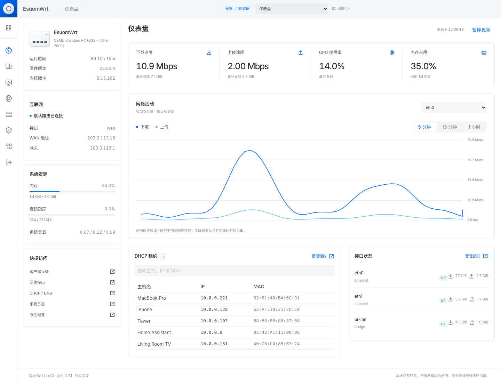
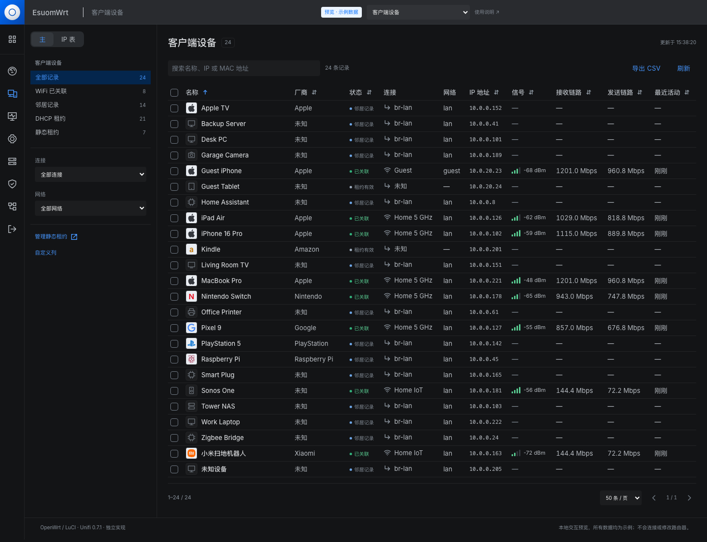
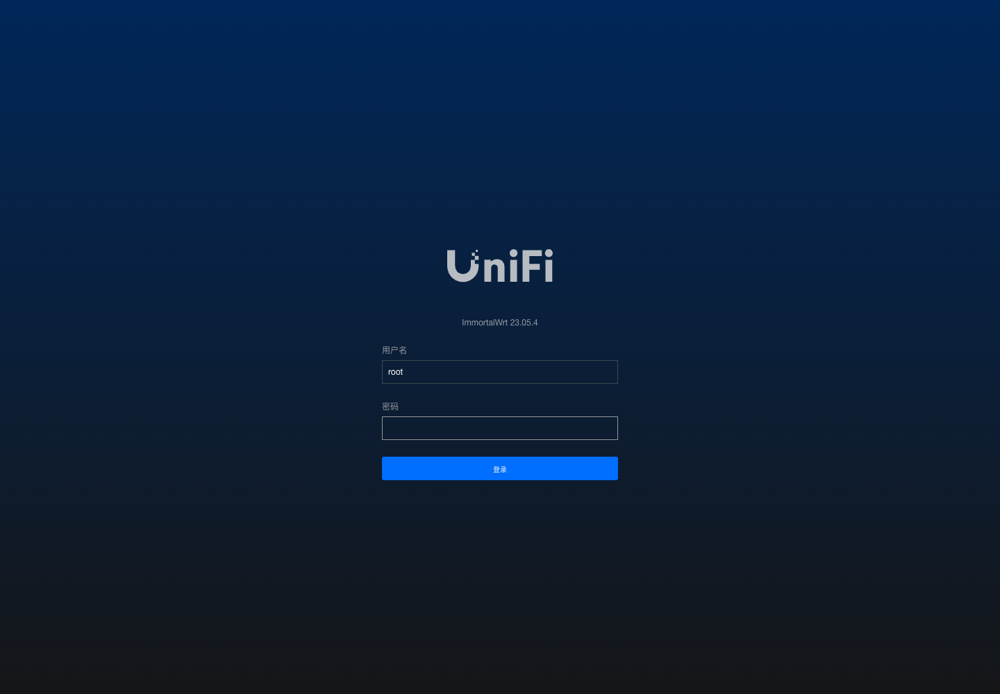

# luci-theme-unifi

为 OpenWrt 和 ImmortalWrt 制作的 UniFi 风格主题，提供实时仪表盘、客户端列表和浅深色模式。

[English](../README.md) · [安装](#安装) · [开发指南](development.zh-CN.md)

<p align="center">
  <a href="images/dashboard.png"></a>
  <a href="images/clients-dark.png"></a>
  <a href="images/login.png"></a>
</p>

## 功能

- **仪表盘**：查看接口流量、CPU、内存、运行时间和网络状态，可选后台采样，在内存中保留最近 1 小时的记录。
- **客户端设备**：支持搜索、筛选、设备详情、自定义列及 CSV 导出，内置离线厂商识别提示。
- **浅深色外观**：跟随系统或手动切换，适配桌面和手机。
- **LuCI 集成**：紧凑导航栏、独立登录页和内置主题设置，保留原生配置页面与认证流程。

## 兼容性

面向基于 OpenWrt / ImmortalWrt 23.05、使用 **ucode 版 LuCI** 和 **opkg** 的固件。仪表盘、主题设置及后台采集已在 ImmortalWrt 23.05.4 上验证，当前登录页仅完成本地检查。旧版纯 Lua LuCI、APK 固件及第三方插件布局尚未验证。

依赖：`luci-base`、`luci-theme-bootstrap`、`luci-mod-status`、`ucode-mod-uloop`，安装时由包管理器从固件软件源获取。

## 安装

在电脑上进入仓库根目录，使用 Python **3.9+** 生成 IPK：

```sh
python3 tools/build_package.py
```

将生成的 `artifacts/luci-theme-unifi_*.ipk` 上传至路由器 `/tmp/`，通过 SSH 在路由器上执行：

```sh
opkg update
opkg install /tmp/luci-theme-unifi_*.ipk
```

在 **系统 → 系统 → 语言和界面** 中选择 **Unifi**，保存并应用。安装主题不会自动切换当前外观。

在 **系统 → Unifi 主题设置** 中调整外观、刷新间隔、分页和导航栏。“总是采样网络活动”默认开启，关闭仪表盘仍会采集；历史仅保存在内存中，路由器或采集服务重启后清空。

**升级**：先切换到其他主题，再安装新版本，完成后重新选择 Unifi。正常升级会保留 `/etc/config/unifi` 中的设置。

**卸载**：先切换到其他主题，再执行：

```sh
opkg remove luci-theme-unifi
```

备份及通过 SSH 恢复主题的方法见[开发指南](development.zh-CN.md#恢复与卸载)。

## 本地预览与开发

无需路由器，使用 Python 3.9+ 即可预览：

```sh
python3 tools/preview_server.py
```

打开 [127.0.0.1:8765](http://127.0.0.1:8765/)。预览使用虚构数据，不连接路由器。

SDK 构建、测试、厂商数据更新及发布打包见[开发指南](development.zh-CN.md)。反馈问题时，请附固件、LuCI 和主题版本、浏览器、受影响页面及复现步骤。

## 许可与致谢

原创代码采用 [Apache-2.0](../LICENSE) 许可。感谢 LuCI Bootstrap、Inter、Simple Icons 和 IEEE Registration Authority 提供模板、字体、图标及 MAC 前缀数据。

第三方素材保留各自的许可与权利：[Inter / OFL](../htdocs/luci-static/unifi/fonts/LICENSE.txt)、[Simple Icons / CC0](../root/usr/share/licenses/luci-theme-unifi/Simple-Icons-CC0.txt)、[UniFi 字标权利说明](../htdocs/luci-static/unifi/login-wordmark.NOTICE)。

UniFi 为 Ubiquiti Inc. 的商标。本项目为独立社区主题，与 Ubiquiti、OpenWrt 或 ImmortalWrt 无隶属关系。
